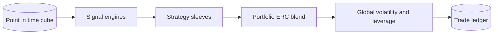

# Modelling, strategies, and portfolio

## Layer boundaries

The three layers have separate contracts:

| Layer | Location | Responsibility |
| --- | --- | --- |
| Signal engines | [src/modelling](../modules/modelling.md) | Train cross-sectional ensembles, report diagnostics and a label-only backtest, and produce scores. |
| Strategy sleeves | [src/strategies](../modules/strategies.md) | Convert one engine/data contract into a self-contained return stream and tradeable book. |
| Portfolio and execution | [src/portfolio](../modules/portfolio.md) | Align sleeves, allocate risk, target portfolio volatility, and persist trade moves. |

A sleeve never depends on another sleeve. The portfolio is the only component that sees and blends all sleeve return streams.

## Sleeve registry

| Sleeve name | Config key | Engine | Role |
| --- | --- | --- | --- |
| `ls_equity` | `strategy_ls` | long/short ensemble | Market-, beta-, and sector-controlled equity alpha, evaluated out of sample. |
| `eq_long_only` | `strategy_eq_long_only` | long/short ensemble | Top-name long-only expression suitable for accounts without shorting. |

The registry is [STRATEGY_REGISTRY](../../src/strategies/__init__.py). Sleeve names do not map mechanically to YAML keys, so every implementation declares `config_key`.

## Strategy contract

[base.py](../../src/strategies/base.py) defines the shared objects:

- `PortfolioInputs`: capital, target volatility, start/end dates, fee and spread assumptions, risk-free rate, and analysis flags supplied by the portfolio.
- `StrategyResult`: sleeve name, net daily returns, metrics, positions, trades, extras, and the exact `book_weights` / `book_prices` used to create trades.

The book panels are essential. Portfolio allocation varies through time, and share quantities are a nonlinear function of capital and integer rounding; the ledger must rebuild the blotter from the scaled book rather than multiply already-created trade dollars.

## Long/short training lifecycle

[StepLongShort](../../src/modelling/steps/step_long_short.py) exposes three behaviors (`run()` is `run_train()`):

| CLI behavior | Method | Contract |
| --- | --- | --- |
| Holdout training | `run_train()` | Train between configured boundaries, run time-series CV, diagnostics and the per-horizon label-only backtest, and produce out-of-sample artifacts. |
| Production refit | `run_train(full_history=True)` | Fit through the latest eligible cube date with no holdout. Daily prediction reads these artifacts. |
| Latest prediction | `run_predict(n_dates=...)` | Load production artifacts, score the newest unlabelled cube rows, and write `predictions_latest` without retraining. |

The weekly order remains holdout training → portfolio backtest → full-history refit in [dag_modelling.py](../../src/dags/dag_modelling.py). Holdout training runs five folds once, saves per-horizon selected LightGBM iteration counts and OOF metrics, and fits the cutoff artifact using median counts. Production full-train reuses that saved selection without CV, fitting every eligible matured row with unchanged learning rate and parameters. Linear/RF receive all eligible rows. Last-outer-test rows and their original fold models supply validation SHAP/PDP; final fitted-row explanations are not OOF evidence.

The requested training end is a feature ceiling X; the observation cutoff includes its longest label endpoint, capped by available complete sessions. Label ends use distinct observed price-part sessions before labelled-row filtering. Inner training labels end strictly before validation; outer training labels end strictly before test. Portfolio evaluation must begin after the latest fitted label end. The current configuration uses X=2022-01-01, maximum horizon90 sessions and portfolio start2022-06-01. Actual fitted feature/label endpoints and dropped rows are recorded separately.

## Model completion criteria

A model family is not complete until it has:

1. time-series cross-validation with an embargo that blocks overlapping forward-label windows;
2. validation-row diagnostics, including SHAP for booster members;
3. printed per-fold and aggregate out-of-fold metrics; and
4. persisted artifacts that round-trip through the production prediction path.

Every member, of any family, serializes as one pickle of its fitted transformer (`model_h<h>_<family>.pkl`, without context, config or logger), so a new family round-trips with no extra persistence code.

## PEGY from reported earnings

`_pegy_fields` in [fundamental_features.py](../../src/data_aggregate/utils/fundamentals/fundamental_features.py) calculates trailing P/E divided by reported quarterly EPS growth plus dividend yield, with both denominator inputs expressed in percentage points. The growth input is the latest published `eps_actual` divided by the actual four reports earlier, minus one. Both EPS values must be positive; report dates must span four calendar quarters because the archive has no fiscal-period key. Incomplete comparisons and a nonpositive combined denominator are undefined. Date-only earnings releases enter the growth input on the next trading session, and observations expire after the existing 185-day quarterly freshness window. A newly reported invalid growth value clears the preceding value.

PEGY never reads `eps_estimate`. When the entire earnings archive is absent, its existing fallback uses realized fiscal net-income growth from the merged fundamentals history. [PEGY regressions](../../tests/data_aggregate/test_fundamental_features.py) check arithmetic, next-session visibility, estimate/future-actual invariance, missing quarters and invalid EPS bases. Historical actuals can still be revised or change accounting basis; this change removes the estimate-vintage dependency rather than certifying those source histories.

Rebuild the full fundamentals cube part and assemble the cube before using the changed `f_pegy` and its derived views historically. An incremental tail would leave the old definition in earlier rows and self-history inputs. The [earnings builder](../../src/data_aggregate/utils/fundamentals/earnings_features.py) now exposes report-associated expectations only after an actual-bearing event, on the next trading session. f_reported_expected_eps_yield, f_reported_expected_ttm_yield and f_reported_expected_eps_growth_qoq replace the old forward-labelled names; the firsttwo retain their history views. Expected TTM uses the current report's estimate plus three preceding actual quarters. Unknown share bases are masked, invalid new reports clear prior state, and the existing185day freshness cap applies. These are archived report-time expectations, not historical forward-consensus vintages. Full derived-history rebuild remains necessary before adoption.

## Report-time EPS observations

[earnings_features.py](../../src/data_aggregate/utils/fundamentals/earnings_features.py) exposes the consensus stored with a completed report, rather than treating it as a historical forecast of the next report:

| Old name | Replacement | Meaning |
| --- | --- | --- |
| `f_fwd_eps_yield` | `f_reported_expected_eps_yield` | Reported-quarter consensus EPS divided by the current compatible share price. |
| `f_forward_earnings_yield` | `f_reported_expected_ttm_yield` | That consensus plus the three preceding actual quarters, divided by current compatible price. |
| `f_eps_expectation_growth` | `f_reported_expected_eps_growth_qoq` | That consensus relative to the immediately preceding positive actual EPS, minus one. |

The first two retain their `_vs_hist` views. An event requires a non-null actual (zero is valid), appears on the next observed trading session and expires after 185 calendar days. A scheduled event without an actual is not an observation. An invalid replacement clears earlier state. Comparisons without supported EPS/share units remain unknown; the archive does not certify historical estimate revisions or split-adjustment vintages. These are report-time observations, not next-quarter forecasts.

## Six additional fundamental feature families

The fixed output schema in [feature_views.py](../../src/data_aggregate/utils/fundamentals/feature_views.py) contains 217 columns: 136 raw, 79 self-history and two explicit peer views. Seventeen additions are:

| Family | Columns | Calculation and interpretation |
| --- | --- | --- |
| Earnings history | `f_earnings_sue_lag0` through `f_earnings_sue_lag7`; `f_earnings_improvement_streak` | Seasonal quarterly net-income change, standardized by the sample deviation of eight prior seasonal changes; eight lag slots and a positive-change streak capped at eight. The current change is excluded from its scale. |
| Price response to reports | `f_earnings_abret_3d`; `f_earnings_abret_since_report` | Separately compounded stock and existing sector-basket total returns, then their difference, anchored before report availability. The three-session value appears only after all three sessions complete. |
| Peer comparisons | `f_fcf_to_ev_vs_peers`; `f_roic_incl_intangibles_vs_peers` | The existing peer comparison and support policy applied to these two raw characteristics. Peer construction is unchanged. |
| Loss-safe improvement | `f_profit_improvement_to_assets` | Change in trailing-year net income against four fiscal quarters earlier, divided by mean positive assets excluding leases at the two endpoints. It supports loss-to-profit transitions. |
| Persistence | `f_roa_vol_8q`; `f_fcf_positive_fraction_8q` | ROA volatility and fraction of positive free-cash-flow observations across eight contiguous fiscal quarters. |
| Operating-cash-flow yield | `f_ocf_yield` | Signed trailing operating cash flow divided by current positive market capitalization. This is cash before capital expenditure, unlike free-cash-flow yield. |

Fiscal histories use distinct quarters and then-public filings; later amendments change subsequent observations only. Missing quarters are not bridged, missing returns are not zero-filled, and zero scale is undefined. Calculations are owned by [history_features.py](../../src/data_aggregate/utils/fundamentals/history_features.py), [disclosure_features.py](../../src/data_aggregate/utils/fundamentals/disclosure_features.py), and [fundamental_features.py](../../src/data_aggregate/utils/fundamentals/fundamental_features.py). Existing raw eligibility leaves some sector comparisons unsupported: the measured FCF/EV peer snapshots have no Utilities coverage. Missingness is retained.

## Historical adoption

After this definition/schema change, fully rebuild fundamentals and assemble the cube before training. A tail refresh leaves mixed historical definitions. Existing earnings-related names in the persisted cube are explicitly rejected, and prediction rejects absent artifact inputs. Run holdout `modelling train` first to create compatible fold-selection metadata; then `modelling full-train` can reuse it. The operational command sequence is in [run the pipeline](../guides/run-the-pipeline.md); the training process is in [the training flow](../flows/model-training-and-prediction.md).

## Workforce features

`StepCubeFundamentals` loads `fundamentals_employees` itself: projected to the keys, components and basis, scoped to the universe, and read from two years before the build start so the first in-window growth has its prior year. The merged `fundamentals_history` carries no headcount. [employee_features.py](../../src/data_aggregate/utils/fundamentals/employee_features.py) builds `revenue_per_employee`, `employee_growth`, `revenue_per_employee_growth` and `headcount_elasticity`.

- **Join.** Each counted employee row is attached backward as-of to the ticker's `fundamentals_history` rows filed on or after it, within 370 days (`SHARADAR_SEC_ASOF_TOLERANCE_DAYS`). Revenue and headcount therefore come from the same then-public history row and nothing is visible before it; a count filed after its 10-K history row (a 10-K/A) appears at the next history row. Status-only rows are dropped first and do not cut the carry. Values project from the history row's `as_of` and expire after 460 days.
- **Proxy.** The headcount the features use depends on the stored components:

| Stored components | Basis | Headcount proxy |
| --- | --- | --- |
| FT and PT | `full_part` | FT + α·PT |
| total and FT, no PT | `full_part` | FT + α·(total − FT) |
| total | `total`, `fte` or `total_incl_contractors` | total |
| FT only | `full_time_only` | FT |

  α is `build_cube.workforce.part_time_weight` in [build_cube.yml](../../configs/build_cube.yml) (0.65). It must lie in [0.5, 1]; any other value raises.
- **Basis rule.** `employee_growth`, `revenue_per_employee_growth` and `headcount_elasticity` are NaN when the proxy's basis differs from its basis a fiscal year earlier, and the daily carry stops at the switch, so a pre-switch growth never stays visible across it. `revenue_per_employee` uses the proxy and is not masked.

After employee rows change, rebuild `cube_part_fundamentals` with `-F`: the 45-session incremental tail does not rewrite older feature dates.

## Cube loading and memory

Training resolves the union of configured family features against the actual cube schema, then loads one target horizon at a time with an explicit projection, labelled-row filter, and float32 downcast. Do not load the full wide cube or all horizons into one frame.

Latest prediction uses a separate feature-only path. The newest cube rows correctly have null forward labels; reusing the labelled training loader would silently drop the observations production needs to score.

## Artifact contract

Model files and metadata live under `model.models_dir` (default `output/models`, relative to the data store; resolved by `utils.artifacts.models_dir`). `metadata.json` is the compatibility contract consumed by the daily predictor, strategies, and Streamlit app; it is stamped `artifact_format: transformer-pickle-v1`, and metadata without that stamp raises a "retrain" error. It records:

- horizons and target type;
- global and family/horizon-resolved feature lists;
- categorical columns;
- actual training boundaries and full-history status; and
- non-negative per-horizon training IC-IR weights for blending.

Per-run diagnostics (the `Monitor`) live under a timestamped diagnostics directory and include horizon KPIs with the OOS cumulative-IC drawdown, feature importance, sampled SHAP matrices, dependence plots, PDPs, the label-only quantile backtest (`backtest_*.csv`, `backtest.png`, `bt_*` KPI columns), and a flat comparison table. Database outputs remain in `predictions`, `cube_signal`, and `predictions_latest`.

## Long/short construction

The [long/short strategy](../../src/strategies/step_ls.py) transforms scores into a constrained book.

- Covariance mode uses shrunk idiosyncratic covariance, reducing duplicated correlated risk. Diagonal mode is inverse variance; full covariance shrinkage toward one becomes the diagonal.
- Dollar, beta, and sector constraints are applied at construction.
- Turnover is controlled through partial movement toward target, a no-trade band, and rebalance frequency.
- Horizon blending uses the training IC-IR weights with configurable shrinkage.
- Whole-share mode solves an integer projection under exposure and gross constraints. Fractional longs can absorb rounding while shorts remain integer.
- Size is neutralized in the target, not in the live book; target construction is therefore responsible for preventing a pure size signal.

Small nominal capital can make integer-share portfolios collapse. Validate position count, gross exposure, neutrality residuals, and turnover under the intended capital.

## Other sleeves

The equity long-only sleeve scores the same ensemble and returns the same `StrategyResult` shape. The multi-asset `long_book` and `trend_cta` sleeves were removed in 2026-10; a new sleeve registers in `STRATEGY_REGISTRY` and follows the same contract.

Any sleeve-specific leverage used to create trades must be represented consistently in its returned book panels. Summary `positions` may intentionally show a different diagnostic view.

## Portfolio blend

[StepPortfolio](../../src/portfolio/step_portfolio.py) reads [portfolio.yml](../../configs/portfolio.yml), builds common inputs, runs configured sleeves, aligns their daily net returns, and calls [blend.py](../../src/portfolio/utils/blend.py).

ERC is the dynamic dollar allocation: covariance-aware equal risk contribution determines sleeve weights, followed by one global volatility target and leverage cap. Inverse-volatility mode is available as a simpler alternative. The portfolio reports sleeve metrics alongside global performance and writes analysis artifacts under the configured output path.

## Strategy moves and ledger

[StepStrategyMoves](../../src/portfolio/step_strategy_moves.py) reuses the portfolio blend, then:

1. multiplies each sleeve's original book weights by time-varying ERC allocation and portfolio leverage;
2. recomputes share-level trades with sleeve prices and trading costs;
3. FIFO-matches entries and exits through [positions.py](../../src/strategies/utils/positions.py); and
4. upserts `strategy` rows so an earlier opening trade can gain exit price and realized P&L when closed.

Scaling an existing blotter is incorrect because capital, weights, prices, and integer constraints vary by date.

## Reviewing a model or strategy change

Review in this order:

1. verify point-in-time inputs and holdout separation;
2. prune or add features using SHAP, coefficient evidence, and fold stability;
3. sanity-check every monotonic direction;
4. compare ensemble predictions, cross-fold IC/IR, turnover, exposures, and realized portfolio behavior—not only mean IC;
5. compare flat per-run KPI artifacts under the same scope; and
6. run the relevant [validation](../guides/validate-a-change.md) with a printed economic conclusion.

Historical benchmark metrics are sanity bars, not acceptance targets; data coverage, labels, and folds can change.

## Related

- [Feature-to-portfolio architecture](../architecture/feature-to-portfolio.md)
- [Modelling module](../modules/modelling.md)
- [Strategies module](../modules/strategies.md)
- [Portfolio module](../modules/portfolio.md)
- [Model training flow](../flows/model-training-and-prediction.md)
- [Portfolio-to-ledger flow](../flows/portfolio-to-trade-ledger.md)
- [Configuration](./configuration.md)

## Explicit development and sealed assessment

[StepAssessLongShort](../../src/modelling/steps/step_assess_long_short.py) provides `modelling assess` with development, evaluation and artifact-only report stages. The h60 z-score protocol develops from 1999 using five forward crisis-aware folds; every fitted outcome ends by 2021-12-31. The frozen cutoff models evaluate formation dates from 2022-01-03. These clocks differ from ordinary training's feature ceiling and production full-history refit.

Each family can retain its own numeric and categorical pool. Development optimizes pooled daily Spearman IC-IR, defined as mean daily IC divided by population IC dispersion times sqrt(252/60); it is not portfolio-return IR. Repeated pruning makes development results selection-biased. Evaluation cannot choose another pool. Benchmark cohorts are fixed highest-prediction ceil(N/10) equal-weight names before outcomes; every h60 price path and matched SPY window must be supported. Missing selected outcomes retain their original missing weights. Overlapping gross windows are not compounded into a portfolio curve.

SHAP and genuine PDP show fitted-model relationships, with original fold provenance and imposed directions disclosed. Research interpretation may propose a separate future constraint experiment; it cannot change current directions after evaluation. Retrospective classifications/peer vintages and current-roster coverage limit historical/generalization claims. See [configuration](./configuration.md) and [testing](../guides/testing.md).
