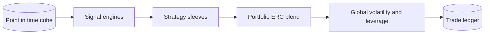

# Modelling, strategies, and portfolio

## Layer boundaries

The three layers have separate contracts:

| Layer | Location | Responsibility |
| --- | --- | --- |
| Signal engines | [src/modelling](../modules/modelling.md) | Train cross-sectional ensembles, recompute saved-model diagnostics in assess, and produce scores. |
| Strategy sleeves | [src/strategies](../modules/strategies.md) | Convert one engine/data contract into a self-contained return stream and tradeable book. |
| Portfolio and execution | [src/portfolio](../modules/portfolio.md) | Align sleeves, allocate risk, target portfolio volatility, and persist trade moves. |

A sleeve never depends on another sleeve. The portfolio is the only component that sees and blends all sleeve return streams.

## Sleeve registry

| Sleeve name | Config key | Engine | Role |
| --- | --- | --- | --- |
| `ls_equity` | `strategy_ls` | long/short ensemble | Market-, beta-, and sector-controlled equity alpha, evaluated out of sample. |
| `eq_long_only` | `strategy_eq_long_only` | long/short ensemble | Top-name long-only expression suitable for accounts without shorting. |

The registry is [STRATEGY_REGISTRY](../../src/strategies/__init__.py). Sleeve names do not map mechanically to YAML keys, so every implementation declares `config_key`.

## Strategy contract

[base.py](../../src/strategies/base.py) defines the shared objects:

- `PortfolioInputs`: capital, target volatility, start/end dates, fee and spread assumptions, risk-free rate, and analysis flags supplied by the portfolio.
- `StrategyResult`: sleeve name, net daily returns, metrics, positions, trades, extras, and the exact `book_weights` / `book_prices` used to create trades.

The book panels are essential. Portfolio allocation varies through time, and share quantities are a nonlinear function of capital and integer rounding; the ledger must rebuild the blotter from the scaled book rather than multiply already-created trade dollars.

## Long/short training lifecycle

The weekly [DAG](../../src/dags/dag_modelling.py) runs four tasks under the safe run ID generated automatically by train and pinned downstream through XCom:

| Task | Method | Contract |
| --- | --- | --- |
| train_model | [StepLongShort.run_train()](../../src/modelling/steps/step_long_short.py); run() delegates here | Save five original purged folds per model/horizon, then fresh cutoff refits. Fixed pools and parameters; no feature search. |
| backtest_modelling | [StepAssessLongShort.run()](../../src/modelling/steps/step_assess_long_short.py) | Read saved models only; save per-member/ensemble IC/IR, SHAP or linear contributions, cutoff PDP and the five-chart offline report. |
| backtest_portfolio | [StepPortfolio.run()](../../src/portfolio/step_portfolio.py) | Use the same run's cutoff members and dated portfolio output. Existing rules, dates and costs remain configured. |
| full_train | StepLongShort.run_train(full_history=True) | Reuse that run's saved fold counts without CV; refit all latest mature labels and atomically publish a complete production generation. |

The five forward windows cover 2000–02,2003–06,2007–12,2013–18 and2019–21 with expanding training from 1999. train.end_date is a feature ceiling. train.outcome_cutoff=2021-12-31 additionally requires all development, early-stop and test outcomes to be known by that date. Actual price-calendar label ends purge training before each external test. LightGBM uses the labelled external test for RMSE early stopping on all eligible training rows; no inner validation tail is withheld. Fold IC/IR therefore includes iteration-selection influence. Cutoff/full-history rounds are the upward-rounded mean of the last two configured chronological folds. Fixed-cutoff assessment begins 3 January 2022; portfolio start remains 1 June 2022. Production fitting ignores the old development ceilings and uses all finite mature labels.

Each original fold supplies its held-out signed-effect curve; a fresh cutoff member supplies the 2022+ curve, sampled tree scatter and PDP. Cutoff refitting uses all eligible development rows, rather than averaging the five folds. Linear importance is absolute standardized beta; signed beta contributions are labelled separately from SHAP. The already-inspected 2022+ backtest is not a new sealed evaluation; current-roster coverage, retrospective classifications and static peer vintages remain historical/generalization limits. See [report plots](../modules/modelling.md#report-plots).

[Artifact utilities](../../src/modelling/utils/artifacts.py) retain folds/cutoff/full-history evidence under configured output/modelling_backtest/<run_id>. Production output/models holds immutable generations plus one atomic metadata switch; readers pin one snapshot for all member loads. Daily production readers also accept legacy flat transformer pickles; dated assessment requires new-workflow training. Dated assessment and [portfolio backtest](../../src/portfolio/cli.py) require the original member inventory before consuming the selected models; completeness and byte verification remain owned by the shared loader. latest.json denotes assessment success only. Any failed task blocks later tasks and retains previous production. Every train creates a fresh run; assess always recomputes current data/model scores, metrics and explanations. There is no partial resume or report-only mode. Standalone assess selects latest completed training; portfolio/full-train select latest successfully assessed training, with optional exact --run-id. Full-train restores saved fitting settings and exact resolved schema. Daily run_predict scores newest feature-only rows without retraining. See [run and retry commands](../guides/run-the-pipeline.md#dated-modelling-assessment).

## Model completion criteria

A model family is not complete until it has:

1. time-series cross-validation with an embargo that blocks overlapping forward-label windows;
2. assessment of original fold-test rows, including SHAP for booster members, owned exclusively by assess;
3. printed per-fold and aggregate out-of-fold metrics; and
4. persisted artifacts that round-trip through the production prediction path.

Every member, of any family, serializes as one pickle of its fitted transformer (`model_h<h>_<family>.pkl`, without context, config or logger), so a new family round-trips with no extra persistence code.

## PEGY from reported earnings

`_pegy_fields` in [fundamental_features.py](../../src/data_aggregate/utils/fundamentals/fundamental_features.py) calculates trailing P/E divided by reported quarterly EPS growth plus dividend yield, with both denominator inputs expressed in percentage points. The growth input is the latest published `eps_actual` divided by the actual four reports earlier, minus one. Both EPS values must be positive; report dates must span four calendar quarters because the archive has no fiscal-period key. Incomplete comparisons and a nonpositive combined denominator are undefined. Date-only earnings releases enter the growth input on the next trading session, and observations expire after the existing 185-day quarterly freshness window. A newly reported invalid growth value clears the preceding value.

PEGY never reads `eps_estimate`. When the entire earnings archive is absent, its existing fallback uses realized fiscal net-income growth from the merged fundamentals history. [PEGY regressions](../../tests/data_aggregate/test_fundamental_features.py) check arithmetic, next-session visibility, estimate/future-actual invariance, missing quarters and invalid EPS bases. Historical actuals can still be revised or change accounting basis; this change removes the estimate-vintage dependency rather than certifying those source histories.

Rebuild the full fundamentals cube part and assemble the cube before using the changed `f_pegy` and its derived views historically. An incremental tail would leave the old definition in earlier rows and self-history inputs. The [earnings builder](../../src/data_aggregate/utils/fundamentals/earnings_features.py) now exposes report-associated expectations only after an actual-bearing event, on the next trading session. f_reported_expected_eps_yield, f_reported_expected_ttm_yield and f_reported_expected_eps_growth_qoq replace the old forward-labelled names; the firsttwo retain their history views. Expected TTM uses the current report's estimate plus three preceding actual quarters. Unknown share bases are masked, invalid new reports clear prior state, and the existing185day freshness cap applies. These are archived report-time expectations, not historical forward-consensus vintages. Full derived-history rebuild remains necessary before adoption.

## Report-time EPS observations

[earnings_features.py](../../src/data_aggregate/utils/fundamentals/earnings_features.py) exposes the consensus stored with a completed report, rather than treating it as a historical forecast of the next report:

| Old name | Replacement | Meaning |
| --- | --- | --- |
| `f_fwd_eps_yield` | `f_reported_expected_eps_yield` | Reported-quarter consensus EPS divided by the current compatible share price. |
| `f_forward_earnings_yield` | `f_reported_expected_ttm_yield` | That consensus plus the three preceding actual quarters, divided by current compatible price. |
| `f_eps_expectation_growth` | `f_reported_expected_eps_growth_qoq` | That consensus relative to the immediately preceding positive actual EPS, minus one. |

The first two retain their `_vs_hist` views. An event requires a non-null actual (zero is valid), appears on the next observed trading session and expires after 185 calendar days. A scheduled event without an actual is not an observation. An invalid replacement clears earlier state. Missing or incompatible quoted-security units remain unknown. A later stock split does not exclude an earlier report or otherwise valid cross-split quarterly comparisons; the unit guard in `_supported_eps_basis()` checks quoted-security units only. EPS and price still require a compatible basis, and the archive does not certify historical estimate revisions or split-adjustment vintages. These are report-time observations, not next-quarter forecasts. [Report feature tests](../../tests/data_aggregate/test_earnings_features.py) cover split invariance alongside the retained unit, timing, freshness and quarter-completeness guards.

## Six additional fundamental feature families

The fixed output schema in [feature_views.py](../../src/data_aggregate/utils/fundamentals/feature_views.py) contains 218 columns: 137 raw, 79 self-history and two explicit peer views. Seventeen additions are:

| Family | Columns | Calculation and interpretation |
| --- | --- | --- |
| Earnings history | `f_earnings_sue_lag0` through `f_earnings_sue_lag7`; `f_earnings_improvement_streak` | Seasonal quarterly net-income change, standardized by the sample deviation of eight prior seasonal changes; eight lag slots and a positive-change streak capped at eight. The current change is excluded from its scale. |
| Price response to reports | `f_earnings_abret_3d`; `f_earnings_abret_since_report` | Separately compounded stock and existing sector-basket total returns, then their difference, anchored before report availability. The three-session value appears only after all three sessions complete. |
| Peer comparisons | `f_fcf_to_ev_vs_peers`; `f_roic_incl_intangibles_vs_peers` | The existing peer comparison and support policy applied to these two raw characteristics. Peer construction is unchanged. |
| Loss-safe improvement | `f_profit_improvement_to_assets` | Change in trailing-year net income against four fiscal quarters earlier, divided by mean positive assets excluding leases at the two endpoints. It supports loss-to-profit transitions. |
| Persistence | `f_roa_vol_8q`; `f_fcf_positive_fraction_8q` | ROA volatility and fraction of positive free-cash-flow observations across eight contiguous fiscal quarters. |
| Operating-cash-flow yield | `f_ocf_yield` | Signed trailing operating cash flow divided by current positive market capitalization. This is cash before capital expenditure, unlike free-cash-flow yield. |

Fiscal histories use distinct quarters and then-public filings; later amendments change subsequent observations only. Missing quarters are not bridged, missing returns are not zero-filled, and zero scale is undefined. Calculations are owned by [history_features.py](../../src/data_aggregate/utils/fundamentals/history_features.py), [disclosure_features.py](../../src/data_aggregate/utils/fundamentals/disclosure_features.py), and [fundamental_features.py](../../src/data_aggregate/utils/fundamentals/fundamental_features.py). Existing raw eligibility leaves some sector comparisons unsupported: the measured FCF/EV peer snapshots have no Utilities coverage. Missingness is retained.

## Signed income growth, revenue CAGR and cash runway

[fundamental_features.py](../../src/data_aggregate/utils/fundamentals/fundamental_features.py) adds two raw characteristics and consolidates annual income growth into one corrected definition:

| Feature | Calculation | Applicability |
| --- | --- | --- |
| `f_revenue_cagr_3y` | `(TTM revenue / TTM revenue three fiscal years earlier)^(1/3) - 1` | Both endpoints finite and strictly positive. Fiscal ends match within the existing 45-day tolerance; missing comparable years stay unknown. |
| `f_y_earnings_growth_signed` | `(TTM net income - prior-year TTM net income) / abs(prior-year TTM net income)` | Finite inputs and nonzero prior income. A loss narrowing from -20 to -10 is +0.5; a deepening loss is negative. Small nonzero bases may still produce large values. |
| `f_cash_runway_months` | `12 * cash / (-TTM free cash flow)` | Same-filing finite nonnegative cash and negative FCF, with a known non-Financials sector. Zero cash gives zero months; nonnegative FCF, Financials and missing inputs remain unknown. |

The signed feature replaces both `f_earningsGrowth` and `f_y_earnings_growth`. Its retained history view is `f_y_earnings_growth_signed_vs_hist`, replacing `f_earningsGrowth_vs_hist`. Revenue CAGR and runway have no additional history variants. Quarterly earnings growth and FCF growth keep their existing definitions.

All three are computed from then-public merged fundamentals, visible from `as_of`, and expire after 185 calendar days. Fiscal predecessors admit only amendments already public at the current filing. These three use the opt-in null-state projection in [pit.py](../../src/data_aggregate/utils/common/pit.py): an invalid new filing clears the preceding value instead of carrying it forward. Existing callers retain their previous projection behavior. Cash includes the source short-term-investment component. Runway measures coverage at trailing burn; it does not forecast future funding or spending. Current-roster sector classifications still limit historical sector applicability claims.

The six-year source window already covers the three-year comparison. Use a full historical fundamentals rebuild and assembly before adoption, then recreate compatible model artifacts; an incremental tail cannot migrate earlier earnings-growth definitions. Old annual earnings aliases in a persisted cube are rejected before training. [Feature regressions](../../tests/data_aggregate/test_fundamental_growth_features.py) cover sign transitions, arithmetic, invalid filings, future amendments, fiscal comparability and exact freshness boundaries.

## Historical adoption

After this definition/schema change, fully rebuild fundamentals and assemble the cube before training. A tail refresh leaves mixed historical definitions. Existing earnings-related names in the persisted cube are explicitly rejected, and prediction rejects absent artifact inputs. Run holdout `modelling train` first to create compatible fold-selection metadata; then `modelling full-train` can reuse it. The operational command sequence is in [run the pipeline](../guides/run-the-pipeline.md); the training process is in [the training flow](../flows/model-training-and-prediction.md).

## Workforce features

`StepCubeFundamentals` loads `fundamentals_employees` itself: projected to the keys, components and basis, scoped to the universe, and read from two years before the build start so the first in-window growth has its prior year. The merged `fundamentals_history` carries no headcount. [employee_features.py](../../src/data_aggregate/utils/fundamentals/employee_features.py) builds `revenue_per_employee`, `employee_growth`, `revenue_per_employee_growth` and `headcount_elasticity`.

- **Join.** Each counted employee row is attached backward as-of to the ticker's `fundamentals_history` rows filed on or after it, within 370 days (`SHARADAR_SEC_ASOF_TOLERANCE_DAYS`). Revenue and headcount therefore come from the same then-public history row and nothing is visible before it; a count filed after its 10-K history row (a 10-K/A) appears at the next history row. Status-only rows are dropped first and do not cut the carry. Values project from the history row's `as_of` and expire after 460 days.
- **Proxy.** The headcount the features use depends on the stored components:

| Stored components | Basis | Headcount proxy |
| --- | --- | --- |
| FT and PT | `full_part` | FT + α·PT |
| total and FT, no PT | `full_part` | FT + α·(total − FT) |
| total | `total`, `fte` or `total_incl_contractors` | total |
| FT only | `full_time_only` | FT |

  α is `build_cube.workforce.part_time_weight` in [build_cube.yml](../../configs/build_cube.yml) (0.65). It must lie in [0.5, 1]; any other value raises.
- **Basis rule.** `employee_growth`, `revenue_per_employee_growth` and `headcount_elasticity` are NaN when the proxy's basis differs from its basis a fiscal year earlier, and the daily carry stops at the switch, so a pre-switch growth never stays visible across it. `revenue_per_employee` uses the proxy and is not masked.

After employee rows change, rebuild `cube_part_fundamentals` with `-F`: the 45-session incremental tail does not rewrite older feature dates.

## Cube loading and memory

Training resolves the union of configured family features against the actual cube schema, then loads one target horizon at a time with an explicit projection and float32 downcast. Finite mature labels determine fitting eligibility; feature-only scoring preserves unknown-target titles. Do not load the full wide cube or all horizons into one frame.

Latest prediction uses a separate feature-only path. The newest cube rows correctly have null forward labels. Train, assess and strategy score all eligible features and normalize all finite predictions, then assess IC only where both prediction and realized target are finite.

## Artifact contract

Model files and metadata live under `model.models_dir` (default `output/models`, relative to the data store; resolved by `utils.artifacts.models_dir`). `read_metadata()` in [artifacts.py](../../src/modelling/utils/artifacts.py) accepts legacy flat `transformer-pickle-v1` and generation-aware `transformer-pickle-generation-v2` metadata. Full-history publication verifies a complete immutable generation before atomically switching the root `metadata.json`; prediction and strategy readers pin one metadata snapshot for all member loads. Unsupported formats or training contracts require retraining. Metadata records:

- horizons and target type;
- global and family/horizon-resolved feature lists;
- categorical columns;
- actual training boundaries and full-history status; and
- non-negative per-horizon training IC-IR weights for blending.

Dated original-fold/cutoff members, minimal fitting summaries and resolved configuration live under model.assessment.output_dir/<run_id> (default output/modelling_backtest/<run_id>). Assess freshly computes its own predictions/IC/IR, sampled SHAP or linear contributions, importance/PDP and report.html in that same run. See [dated artifacts](../modules/modelling.md#dated-artifacts-and-production-models). Monitor and label-only Backtest are removed. Train creates no OOF prediction files or historical predictions/cube_signal writes; daily prediction retains predictions_latest.

## Long/short construction

The [long/short strategy](../../src/strategies/step_ls.py) transforms scores into a constrained book.

- Covariance mode uses shrunk idiosyncratic covariance, reducing duplicated correlated risk. Diagonal mode is inverse variance; full covariance shrinkage toward one becomes the diagonal.
- Dollar, beta, and sector constraints are applied at construction.
- Turnover is controlled through partial movement toward target, a no-trade band, and rebalance frequency.
- Horizon blending uses the training IC-IR weights with configurable shrinkage.
- Whole-share mode solves an integer projection under exposure and gross constraints. Fractional longs can absorb rounding while shorts remain integer.
- Size is neutralized in the target, not in the live book; target construction is therefore responsible for preventing a pure size signal.

Small nominal capital can make integer-share portfolios collapse. Validate position count, gross exposure, neutrality residuals, and turnover under the intended capital.

## Other sleeves

The equity long-only sleeve scores the same ensemble and returns the same `StrategyResult` shape. The multi-asset `long_book` and `trend_cta` sleeves were removed in 2026-10; a new sleeve registers in `STRATEGY_REGISTRY` and follows the same contract.

Any sleeve-specific leverage used to create trades must be represented consistently in its returned book panels. Summary `positions` may intentionally show a different diagnostic view.

## Portfolio blend

[StepPortfolio](../../src/portfolio/step_portfolio.py) reads [portfolio.yml](../../configs/portfolio.yml), builds common inputs, runs configured sleeves, aligns their daily net returns, and calls [blend.py](../../src/portfolio/utils/blend.py).

ERC is the dynamic dollar allocation: covariance-aware equal risk contribution determines sleeve weights, followed by one global volatility target and leverage cap. Inverse-volatility mode is available as a simpler alternative. The portfolio reports sleeve metrics alongside global performance and writes analysis artifacts under the configured output path.

## Strategy moves and ledger

[StepStrategyMoves](../../src/portfolio/step_strategy_moves.py) reuses the portfolio blend, then:

1. multiplies each sleeve's original book weights by time-varying ERC allocation and portfolio leverage;
2. recomputes share-level trades with sleeve prices and trading costs;
3. FIFO-matches entries and exits through [positions.py](../../src/strategies/utils/positions.py); and
4. upserts `strategy` rows so an earlier opening trade can gain exit price and realized P&L when closed.

Scaling an existing blotter is incorrect because capital, weights, prices, and integer constraints vary by date.

## Reviewing a model or strategy change

Review in this order:

1. verify point-in-time inputs and holdout separation;
2. prune or add features using SHAP, coefficient evidence, and fold stability;
3. sanity-check every monotonic direction;
4. compare ensemble predictions, cross-fold IC/IR, turnover, exposures, and realized portfolio behavior—not only mean IC;
5. compare flat per-run KPI artifacts under the same scope; and
6. run the relevant [validation](../guides/validate-a-change.md) with a printed economic conclusion.

Historical benchmark metrics are sanity bars, not acceptance targets; data coverage, labels, and folds can change.

## Related

- [Feature-to-portfolio architecture](../architecture/feature-to-portfolio.md)
- [Modelling module](../modules/modelling.md)
- [Strategies module](../modules/strategies.md)
- [Portfolio module](../modules/portfolio.md)
- [Model training flow](../flows/model-training-and-prediction.md)
- [Portfolio-to-ledger flow](../flows/portfolio-to-trade-ledger.md)
- [Configuration](./configuration.md)
